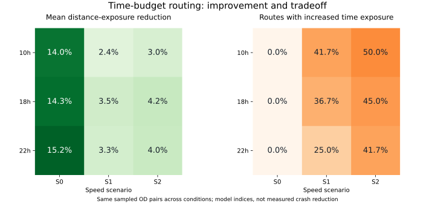

# 3차 개선: 다수 출발·도착 및 시간·속도 조건 비교

기준: PR #2의 `43fc9fff2f79067d6c086593d8bfb0a6245ef4a2`.
2026-10-28 실행. 경로 알고리즘은 PR #2와 동일하게 유지하고 비교 실험의 범위를 넓혔다.
이 결과는 같은 RS를 사용하는 모델 내부 비교이며, 독립적인 사고 위험 검증은 아니다.

## 실험 설계

출발·도착 쌍은 경로 결과를 계산하기 전에 seed 42로 고정했다.

| 항목 | 설정 |
|---|---|
| 출발·도착 | 순서가 있는 서로 다른 60쌍 |
| 거리별 표본 | 직선거리 0.5~1.5km, 1.5~3km, 3~5km에서 각각 20쌍 |
| 시간 | 10시, 18시, 22시 |
| 속도 | S0, S1, S2 |
| 비교 방식 | 순수 최단시간, 기존 λ=0.5, 기존 λ=1, 시간 상한 기반 거리 노출 최소화 |
| 추가시간 상한 | 최단시간 대비 min(10%, 120초) |
| 새 알고리즘 탐색 한도 | 100,000 label, soft runtime 5초 |
| 전체 규모 | 60쌍 × 3시간 × 3시나리오 = 540조건, 총 2,160개 경로 결과 |

방향성 도로망 7,107개 노드의 99개 강연결요소 중 가장 큰 요소(6,982개 노드)를
추출한 뒤 그 안에서 표본을 뽑았다. 나머지 125개 그래프 노드는 사전에 제외했다.
입력 노드 파일 중 도로 arc에 등장하지 않는 노드도 표본에 포함되지 않는다.
서로 도달 가능한 영역에 한정한 실험이며, 연결되지 않는 출발지의 서비스 실패율을 평가한 것은 아니다.
직선거리 구간은 실제 경로거리 구간과 다를 수 있다.

모든 시간·속도 조건에서 동일한 60쌍을 사용했다. 따라서 540개 결과는 서로 독립적인
540번의 이용 기록이 아니다. 거리별 균등 추출도 실제 이용량 분포를 대표하지 않는다.
표본·조건·비교 방식은 결과를 본 뒤 바꾸지 않았으며, 실패가 발생하면 해당 결과를 남기도록 구현했다.

## 결과

새 알고리즘의 540개 결과 모두 추가시간 상한을 충족했고, 주어진 그래프·점수·시간 모델 아래의
제약 최적해로 확인됐다. 실행 오류, 탐색 한도 도달 및 거리 기준 노출 악화는 각각 0개였다.
거리 기준 노출은 499개 조건에서 감소하고 41개에서 동일했다. 모든 노출 지표의 기준은
동일 조건의 순수 최단시간 경로다.

| 속도 시나리오 | 조건 수 | 거리 기준 노출 평균 감소 | 감소율 중앙값 | 시간 기준 노출 증가 | 추가시간 중앙값 |
|---|---:|---:|---:|---:|---:|
| S0: 전 구간 25km/h | 180 | 14.50% | 12.38% | 0/180 (0%) | 23.93초 |
| S1: 기본 등급별 속도 | 180 | 3.07% | 1.39% | 62/180 (34.4%) | 8.80초 |
| S2: 강화 등급별 속도 | 180 | 3.74% | 1.55% | 82/180 (45.6%) | 14.17초 |

세 시나리오를 균등하게 합치면 거리 노출 감소율 평균은 7.10%, 중앙값은 2.33%다.
하지만 S0/S1/S2는 다른 정책 가정이므로 이 평균을 실제 이용자의 기대 개선율로 해석해서는 안 된다.
S1·S2에서는 최단시간 경로 자체가 위험등급에 따른 감속의 영향을 받는다.

시간 기준 노출은 총 144/540개 조건(26.7%)에서 증가했다.
전체 평균만 보면 시간 기준 노출도 감소하지만 개별 경로의 증가를 숨길 수 있으므로,
평균과 증가 건수를 함께 기록한다. 증감 건수의 허용오차는 상대비율 1e-8이다.



시간별 거리 기준 노출 평균 감소율은 다음과 같다.

| 시간 | S0 | S1 | S2 |
|---|---:|---:|---:|
| 10시 | 14.02% | 2.37% | 3.04% |
| 18시 | 14.33% | 3.54% | 4.15% |
| 22시 | 15.15% | 3.31% | 4.01% |

## 기존 λ 방식과 같은 기준으로 비교

| 방식 | 새 시간 상한 초과 | 거리 기준 노출 악화 | 시간 기준 노출 악화 |
|---|---:|---:|---:|
| 기존 λ=0.5 | 305/540 | 376/540 | 357/540 |
| 기존 λ=1 | 362/540 | 379/540 | 358/540 |
| 새 시간 상한 방식 | 0/540 | 0/540 | 144/540 |

기존 방식에는 이 시간 상한이 원래 없으므로, '상한 초과'는 기존 알고리즘의 제약 위반이 아니라
새 허용시간 정책에 맞지 않는 결과를 뜻한다. 기존 λ의 Optimal은 그 부분 그래프와 기존 목적함수에
대한 상태이며 새 알고리즘의 전체 그래프 제약 최적성과 구분해야 한다.

새 방식과의 차이는 목적함수·시간 제약·전체 그래프 사용·회전 및 쾌적성 비용 제외를 함께 포함한다.
따라서 이 표만으로 개별 변경 하나의 기여도나 실제 사고 감소 효과를 분리해 설명할 수 없다.

## 재현 및 결과 파일

```bash
pip install -r requirements-validation.txt
python scripts/17_batch_validate_routes.py
python scripts/18_plot_batch_validation.py
python -m pytest -q
```

기본 실행은 4개 프로세스를 사용한다. 순차 실행은 `--workers 1`로 지정한다.
Linux에서는 fork, fork를 사용할 수 없는 환경에서는 spawn을 선택한다.
이번 검증은 Linux에서 수행했으며 Windows 실제 실행은 확인하지 않았다.

빠른 확인용 실행 예:

```bash
python scripts/17_batch_validate_routes.py --pairs-per-band 1 --hours 18h --scenarios S1 --workers 1 --output-dir data/output/v3_smoke
```

결과는 `data/output/validation_v3/`에 저장한다.

- `sampled_pairs.csv`: 고정한 노드 쌍, 직선거리, EPSG:5179 좌표, 거리 구간.
- `results.csv`: 2,160개 개별 결과. 상태·제약 충족·경로 signature·거리/시간 노출·추가시간·회전 수·탐색 gap 포함.
- `summary.csv`: 시간·시나리오·방식별 집계. 실패·탐색 한도·정의 불가능한 변화율도 별도 집계.
- `summary_by_band.csv`: 거리 구간별 같은 집계.
- `errors.csv`: 오류 결과. 이번 실행은 헤더만 있고 오류 행은 0개다.
- `metadata.json`: 입력 해시, 표본 설계, 기준 소스, 실행 한도, 프로세스 수, 패키지 버전.
- `overview.svg`: 거리 노출 개선과 시간 노출 증가 비율을 함께 보여주는 그림.

기준 노출이 0이면 해당 변화율을 결측으로 두고 정의되지 않은 결과 수를 표시한다.
이번 실행에서는 이런 결과가 없었다. 실패·한도 도달 결과를 제외하고 표본을 다시 추출하지 않는다.
한 시간·시나리오가 끝날 때마다 중간 결과를 저장한다. 실패가 있으면 결과를 저장한 뒤 비정상 종료한다.

새 탐색의 실행시간 중앙값은 약 0.056초, 95백분위는 약 0.084초였다.
공유 그래프 준비와 파일 로딩을 제외한 값이며, 기존 방식의 부분 그래프 준비시간은 별도 열에 기록한다.
서로 다른 준비 비용을 제외한 수치이므로 이 값만으로 전체 서비스 응답속도를 비교하면 안 된다.

## 검증과 다음 판단

테스트 총 41개 통과. 거리별 균등 추출·seed 재현·노드 입력 순서 불변성,
강연결요소 제외, 실패·한도·분모 0 집계 및 일부 방식의 실패가 다른 결과를 숨기지 않는 것을 확인했다.
별도로 동일한 소규모 표본을 순차/병렬 실행해 12개 결과의 경로·지표·상태가 일치하는지 확인했다.
전체 출력의 조건별 60쌍 유지, 중복 여부, 오류·gap·시간 상한 및 거리 노출 비악화도 검사했다.

거리 노출을 직접 최소화했으므로 같은 지표가 감소하는 것은 목적함수 내부의 결과다.
위험 점수의 타당성과 실제 주행 안전성은 독립 사고 데이터와 현장 확인이 필요하다.
RS 모델·edge 대표 위험등급·OSM 접근 제한은 기존 자료를 유지했고,
시간 계산은 신호·회전·가감속·출발/도착 접근시간을 제외한다.

이번 실험에서 확인한 다음 개선 과제는 **시간 기준 위험 노출도 최단시간 경로보다
악화시키지 않는 제약**이다. 특히 S1·S2에서 증가 사례가 적지 않으므로,
거리와 시간 노출을 동시에 관리하는 방식의 탐색 복잡도와 개선폭을 비교할 근거가 생겼다.
회전 지연·쾌적성 비용의 재도입도 별도 비교해야 한다. 이번 PR은 그 정책을 구현한 단계는 아니다.
