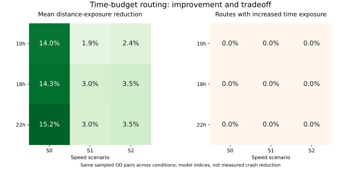

# 4차 개선: 거리·시간 위험 노출을 함께 관리하는 경로

기준: PR #3의 `964d9e438a2c2b355c440bbf10a49c587ee028a4`.
2026-10-28 실행. 추가시간 상한을 지키면서 시간 기준 위험 노출도 기준 경로보다
늘어나지 않도록 제약을 추가했다. 기준 경로는 같은 시간대·속도 시나리오의 순수 최단시간 경로다.

## 목적함수와 보장 범위

```
minimize  Σ (RS_e / 100) × length_e
subject to
  Σ time_e <= T_fastest + min(0.10 × T_fastest, 120 seconds)
  Σ (RS_e / 100) × time_e <= fastest route time exposure
```

거리 노출을 목적함수로 최소화하고, 이동시간과 시간 노출을 제약으로 관리한다.
시간 노출 자체를 가장 작게 만드는 목적함수는 아니다.
기준 최단시간 경로가 두 제약을 만족하므로 최초 후보로 유지할 수 있다.
최적해를 찾지 못하고 탐색 한도에 도달해도 두 제약을 만족하는 후보와 하한·gap을 반환한다.
거리 노출도 기준 경로보다 커지지 않는다. feasibility의 절대 수치 허용오차는 1e-9다.

이 보장은 입력 RS와 속도에 기반한 모델 내부 보장이다. 실제 사고 확률, 실제 소요시간,
실제 보행자 충돌 위험의 비악화를 입증하는 것은 아니다.

## 구현

`ExposureGraph.solve(..., prevent_time_exposure_increase=True)`를 추가했다.
기존 API 동작을 유지하기 위해 옵션 기본값은 False다.
활성화하면 시간·거리 노출·시간 노출의 3개 값으로 label 지배 관계를 판단하고,
목적지까지의 최소 시간 노출 하한으로 추가 가지치기한다.

기존의 2개 값만으로 label을 제거하면, 시간 노출 제약을 만족하는 데 필요한 중간 경로까지
제거할 수 있다. 이 문제를 재현하는 별도 테스트와 작은 순환 그래프의 전 경로 열거 비교를 추가했다.
거리 노출이 가장 작은 경로를 찾은 뒤 시간 노출이 증가하면 무조건 최단시간으로 되돌리는 방식이 아니라,
두 제약 아래에서 다른 우회 경로도 탐색한다.

## 같은 540개 조건에서의 비교

PR #3의 고정 60쌍과 3개 시간대·3개 속도 시나리오를 그대로 사용했다.
입력 파일 해시를 확인하고 최단시간·기존 거리 노출 방식도 다시 실행했다.
이 1,080개 경로의 signature는 PR #3 결과와 모두 일치했다.
표본을 다시 추출하거나 유리한 조건만 선택하지 않았다.

| 시나리오 | 기존 거리 방식의 거리 노출 평균 감소 | 새 공동 제약 방식의 감소 | 기존 평균 개선폭 유지 비율 | 시간 노출 증가: 기존→신규 |
|---|---:|---:|---:|---:|
| S0 | 14.50% | 14.50% | 100% | 0/180→0/180 |
| S1 | 3.07% | 2.65% | 86.1% | 62/180→0/180 |
| S2 | 3.74% | 3.13% | 83.7% | 82/180→0/180 |

평균 감소율의 기준은 동일 조건의 순수 최단시간 경로다. 유지 비율은
`새 방식의 평균 감소율 / 기존 방식의 평균 감소율`로 계산했다.
S1·S2는 거리 노출 개선폭 일부를 줄이는 대신 개별 경로의 시간 노출 증가를 막았다.
새 방식의 시간 기준 노출 평균 감소율은 S1 3.49%, S2 3.60%였다.

새 방식은 540개 전 조건에서 이동시간·시간 노출 제약을 충족했고, 주어진 전체 그래프에서
제약 최적해로 확인됐다. 오류·탐색 한도 도달·거리 노출 악화·시간 노출 악화는 모두 0개다.
거리 노출은 470개 조건에서 감소하고 70개에서 동일했다. 기존 거리 방식은 499개에서 감소했다.



시간별 새 거리 노출 평균 감소율:

| 시간 | S0 | S1 | S2 |
|---|---:|---:|---:|
| 10시 | 14.02% | 1.93% | 2.42% |
| 18시 | 14.33% | 3.04% | 3.46% |
| 22시 | 15.15% | 2.98% | 3.51% |

원래 3개 사례에 대해서도 사용자용 CLI를 실행했다. 같은 좌표와 18시 S1 조건에서,
거리 노출 감소율은 각각 2.14%, 0.25%, 0.81%, 시간 노출 감소율은 0.66%, 0.23%, 0.62%였다.
사례 1의 발표자료 '신논현역' 표기와 저장소 '논현역' 좌표 차이는 이전 단계와 동일하게 남아 있다.

## 실행 방법

```bash
pip install -r requirements-validation.txt

# 3개 사례에서 공동 제약을 활성화한다. 기본 출력과 구분해 저장한다.
python scripts/16_compare_time_budget_routes.py --prevent-time-exposure-increase --output-dir data/output/joint_report_cases

# 사용자 좌표: 경도,위도 순서
python scripts/16_compare_time_budget_routes.py --prevent-time-exposure-increase --start-coords 127.0335,37.4957 --end-coords 127.0625,37.4969 --hour 18h --scenario S1 --output-dir data/output/joint_custom

# PR #3의 540개 조건을 재사용해 비교한다.
python scripts/19_compare_joint_exposure.py
python scripts/18_plot_batch_validation.py --input-dir data/output/validation_v4 --method budget_joint
python -m pytest -q
```

`16_compare_time_budget_routes.py`에서 플래그를 생략하면 이전 거리 노출 방식이 실행된다.
플래그 활성화 결과의 method는 `budget_joint`이고,
`time_exposure_reference_sec`, `within_time_exposure_reference`로 제약을 확인할 수 있다.

`19_compare_joint_exposure.py`는 이전 실험의 입력 해시와 참조 파일을 확인한다.
입력이 달라졌다면 같은 실험으로 비교하지 않고 중단한다.
결과는 `data/output/validation_v4/`의 `results.csv`, `summary.csv`, `sampled_pairs.csv`,
`errors.csv`, `metadata.json`, `overview.svg`에 저장한다.
최단시간·거리 방식·공동 제약 방식 총 1,620개 결과를 포함한다.
한도 도달 결과와 오류도 남기며, 오류가 있으면 저장 후 비정상 종료한다.

## 검증 및 한계

테스트 총 58개 통과. 추가 검증은 3개 자원의 지배 관계, 공동 제약 아래의 전 경로 열거 정답 비교,
개선 경로가 없는 경우 기준 경로 반환, 시간 노출 0, 같은 출발·도착, 탐색 한도 시 feasible 후보,
제약 경계의 등호 및 도로 분할 불변성을 포함한다.
실데이터 1,620행의 키 중복·표본 동일성·두 제약·gap·기존 경로 재현도 확인했다.

공동 제약 탐색의 실행시간 중앙값은 약 0.075초, 95백분위는 약 0.103초였다.
파일 로딩·그래프 준비를 제외한 측정이며, 모든 규모에서 이 응답시간을 보장하는 값은 아니다.
3개 자원을 보존하면서 label 수가 커질 수 있으므로 기본 비교 한도는 100,000 label과 soft 5초다.
한도 도달 결과를 optimal로 취급해서는 안 된다.

같은 60쌍을 조건별로 반복한 모델 내부 비교이고 실제 이용량 분포를 대표하지 않는다.
강연결요소 표본, 기존 RS의 정확도 한계, edge 평균화, OSM 접근 제한 및 회전·신호·가감속 지연 누락은
이전 단계와 동일하다. 회전 편의성이나 고위험 통과거리의 동시 비악화도 이번 제약의 보장 대상이 아니다.
이런 항목은 독립 지표로 계속 확인하고, 실주행·독립 사고 데이터 검증과 구분해야 한다.
