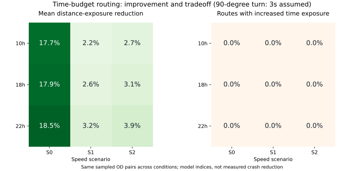

# 5차 개선: 회전 지연과 대기 노출을 포함한 민감도 분석

기준: PR #4의 `ce6626c6c493f254aed281bb3966917d6787f0af`.
2026-10-28 실행. 회전 지연을 이동시간과 시간 기준 노출에 포함하고,
같은 가정으로 계산한 최단시간 경로를 기준으로 공동 제약을 적용했다.
추가시간 상한은 계속 `min(최단시간의 10%, 120초)`다.

## 지연 가정

실측 회전시간이 없으므로 90도 회전에 0초·3초·6초를 더하는 세 가지 민감도 가정을 사용한다.
이 수치는 검증된 운행시간이나 권장 운영 기준이 아니다.

| 회전각 | 추가 지연 |
|---|---|
| 30도 이하 | 0초 |
| 30~150도 | `(각도-30)/60 × 90도 지연값` |
| 90도 | 설정한 지연값 |
| 150도 이상 | 설정값의 2배 |

회전각은 이전 도로 geometry 끝 방향과 다음 도로 시작 방향의 차이로 계산한다.
좌회전·우회전을 구분하지 않고, 신호 주기·교차로별 대기시간도 추정하지 않는다.
첫 도로 진입과 마지막 도로 도착에는 별도 지연을 추가하지 않는다.

모델 시간 노출은 다음처럼 정의했다.

```
이동시간 = Σ 도로 이동시간 + Σ 회전 지연
시간 노출 = Σ (도로 RS/100 × 도로 이동시간)
           + Σ (max(진입도로 RS, 진출도로 RS)/100 × 회전 지연)
```

대기 지점의 RS를 인접 두 도로 중 큰 값으로 두는 것은 대리 지표에 대한 가정이다.
정지 중 실제 위험이 주행 중 위험과 같다는 실측 근거를 제공하는 것은 아니다.
거리 노출은 기존처럼 `Σ(RS/100 × 도로 길이)`로 유지한다.
기존 고위험 통과거리·시간 열은 도로 대표등급과 이동 구간 기준이며 대기 지연을 분해해 배분하지 않는다.

## 알고리즘

`ExposureGraph(arcs, turn_delay=TurnDelayProfile(...))`를 추가했다.
현재 노드뿐 아니라 진입한 arc를 탐색 상태에 포함한다. 같은 교차로라도 진입 방향에 따라
다음 도로의 회전 비용이 달라지기 때문에 노드 하나당 최솟값만 저장해서는 정확한 경로를 찾을 수 없다.
거리·시간 노출 공동 제약도 이 상태 위에서 탐색한다.

역방향 이동시간 및 시간 노출 하한 역시 진입 arc 상태와 회전 비용을 반영한다.
이 하한으로 불가능한 중간 후보를 더 일찍 제거한다. 거리 노출 하한은 기존 도로망 기준으로 계산한다.
`optimal`과 `feasible_limit`을 구분하고, 탐색 종료 사유·노출 하한·상대 gap을 결과에 남긴다.

회전 비용이 있는 상태 경로는 동일한 물리 노드를 다시 지날 수도 있다.
그런 경로를 조용히 제거하거나 연결 오류로 처리하지 않고 재방문 횟수로 기록한다.
교통법상 회전 금지, 반복 통과 금지 등 별도 제약을 적용한 모델은 아니다.

## 실험 범위

PR #4의 같은 60개 출발·도착 쌍, 3개 시간대, S0/S1/S2를 유지하고 세 지연 가정을 적용했다.
총 1,620개 조건에서 다음 세 경로를 비교한다.

- `fastest_turn`: 해당 지연 가정 아래의 최단시간 경로.
- `v4_joint_replayed`: 이전 공동 제약 경로를 고정하고 현재 지연 가정으로 다시 평가한 결과.
- `joint_turn`: 현재 지연 가정 아래에서 이동시간·시간 노출 제약을 지키며 거리 노출을 최소화한 경로.

각 가정에서 기준 경로 자체가 달라질 수 있으므로 가정별 노출 감소율의 분모도 다를 수 있다.
서로 다른 가정의 감소율 차이를 실제 안전성 향상이나 회전 지연 추정의 정확도 차이로 해석하면 안 된다.
같은 60쌍을 반복한 결과이며 실제 이용 수요 분포도 대표하지 않는다.

## 결과

최종 결과는 세 지연 가정 각각 540개, 총 1,620개 공동 제약 경로가 모두 이동시간·시간 노출
상한을 충족했다. 주어진 상태 그래프에서 모두 최적해로 확인됐고, 오류·탐색 한도 도달은 0개였다.
세 비교 방식의 전체 결과는 4,860행이다. 회전 지연 0초의 540개 공동 제약 경로는 PR #4와
signature가 모두 일치했다.

| 90도 회전 지연 가정 | 평균 90도 이상 회전 수 | 고정한 이전 경로 대비 감소 | 거리 노출 감소 조건 | 노드 재방문 조건 |
|---|---:|---:|---:|---:|
| 0초 | 7.87회 | 기준 | 470/540 | 0/540 |
| 3초 | 6.58회 | 16.4% | 417/540 | 0/540 |
| 6초 | 5.84회 | 25.8% | 400/540 | 3/540 |

고정한 이전 경로의 회전 수는 가정에 관계없이 동일하다. 회전 감소율은 이 동일한 경로 집합과
새 경로 집합의 평균 회전 수를 비교했다. 개별 경로마다 회전 수가 줄어든다는 보장은 아니다.
거리 노출 감소 조건의 기준은 각 가정의 최단시간 경로이며, 나머지 조건은 동일한 노출이다.

6초 가정의 새 공동 제약 경로 3개는 물리 노드를 한 번씩 다시 지났다.
같은 가정의 최단시간 경로도 11개 조건에서 노드 재방문이 발생했다.
회전 비용을 피하기 위한 우회가 나타날 수 있으므로, 평균 회전 감소만으로 모든 경로가
자연스러워졌다고 판단하면 안 된다. 회전 허용 정보·실측 지연과 함께 경로를 확인할 과제다.

시나리오별 평균 거리 노출 감소율은 다음과 같다. 각 지연 가정의 최단시간 경로 대비 값이다.

| 회전 지연 가정 | S0 | S1 | S2 |
|---|---:|---:|---:|
| 0초 | 14.50% | 2.65% | 3.13% |
| 3초 | 18.03% | 2.67% | 3.22% |
| 6초 | 17.42% | 3.23% | 3.18% |

위 표는 가정별 기준 경로가 바뀌므로 세 가정을 서로 비교해 실제 위험 감소 효과를 순위화할 수 없다.



이전 공동 제약 경로를 고정하고 회전 지연만 더해 평가하면 다음과 같이 새 기준 상한을 넘는 경우가 있다.

| 지연 가정 | 이동시간 상한 초과 | 시간 노출 상한 초과 |
|---|---:|---:|
| 0초 | 0/540 | 0/540 |
| 3초 | 151/540 | 137/540 |
| 6초 | 217/540 | 187/540 |

이는 이전 알고리즘이 이전 가정의 제약을 위반했다는 뜻이 아니라, 지연 모델을 바꾸면
이전 경로의 제약 보장이 그대로 유지되지 않는다는 뜻이다. 새 알고리즘은 각 모델에서 다시 최적화했다.

최종 탐색에서는 회전 상태를 반영한 역방향 하한을 사용해 최대 label 수가 3초 가정 32,893개,
6초 가정 31,890개였다. 기본 상한 100,000개·soft 5초 이내에서 모두 최적성을 확인했다.
3초/6초 가정의 실행시간 중앙값은 각각 약 0.644초/0.643초였다.
파일 로딩·그래프 준비를 제외한 실험 환경의 수치이며 운영 지연시간 보장이 아니다.

## 실행 방법

```bash
pip install -r requirements-validation.txt

# 개별 3개 사례: 회전 지연 가정 + 공동 제약
python scripts/16_compare_time_budget_routes.py --prevent-time-exposure-increase --turn-seconds-at-90 3 --output-dir data/output/turn_report_cases

# 사용자 좌표(경도,위도)
python scripts/16_compare_time_budget_routes.py --prevent-time-exposure-increase --turn-seconds-at-90 3 --start-coords 127.0335,37.4957 --end-coords 127.0625,37.4969 --output-dir data/output/turn_custom

# 같은 표본 전체 비교
python scripts/20_validate_turn_delay.py
python scripts/18_plot_batch_validation.py --input-dir data/output/validation_v5 --method joint_turn --turn-seconds-at-90 3
python -m pytest -q
```

기본 프로세스 수는 4개이고 `--workers 1`로 순차 실행할 수 있다.
`--pair-limit 2 --hours 18h --scenarios S1`은 빠른 확인용 표본 축소 옵션이다.
축소 실험을 전체 1,620조건 결과와 혼동해서는 안 된다.

회전 지연 기본값은 0이므로 기존 CLI 동작은 유지한다.
`--turn-seconds-at-90`만 지정하면 회전을 고려한 거리 방식,
`--prevent-time-exposure-increase`도 지정하면 공동 제약 방식이다.
지연을 포함한 총시간, 도로 이동시간, 회전 지연, 도로 시간 노출, 회전 대기 노출을 각각 저장한다.

결과는 `data/output/validation_v5/`에 있다.
`results.csv`의 `within_time_budget`, `within_time_exposure_reference`, `solver_status`,
`stop_reason`, `lower_bound_exposure_m`, `relative_gap`, `repeated_nodes`를 함께 확인해야 한다.
오류는 `errors.csv`, 표본·입력 해시와 가정은 `sampled_pairs.csv`와 `metadata.json`에 기록한다.
그림은 `overview_turn_0s.svg`, `overview_turn_3s.svg`, `overview_turn_6s.svg`로 분리한다.

## 검증과 한계

테스트 총 74개가 통과했다. 단위 테스트는 진입 방향 상태의 필요성, 회전·대기 노출 합계, 물리 노드 재방문,
작은 상태 그래프의 전 경로 열거 정답 비교, 역방향 하한, 지연 각도 경계와 잘못된 입력을 검증한다.
비교 코드의 통합 테스트는 같은 지연 모델의 기준 경로를 사용하고, 이전 경로의 제약 불충족을
오류 행으로 숨기지 않고 결과로 기록하는지 확인한다.
실데이터 4,860행의 키·표본 커버리지, 두 제약, gap, 0초 가정의 이전 경로 재현과 SVG 표시도 확인했다.

RS와 속도 시나리오는 그대로 유지했다. 실제 사고 확률, 실측 운행시간, 신호 대기,
좌우 회전 비대칭, 가감속, 출발·도착 접근시간 및 법적 회전 허용 여부는 검증하지 않았다.
회전 지연과 대기 노출 계수를 실주행 기록으로 보정한 뒤 실제 경로 품질을 판단해야 한다.
